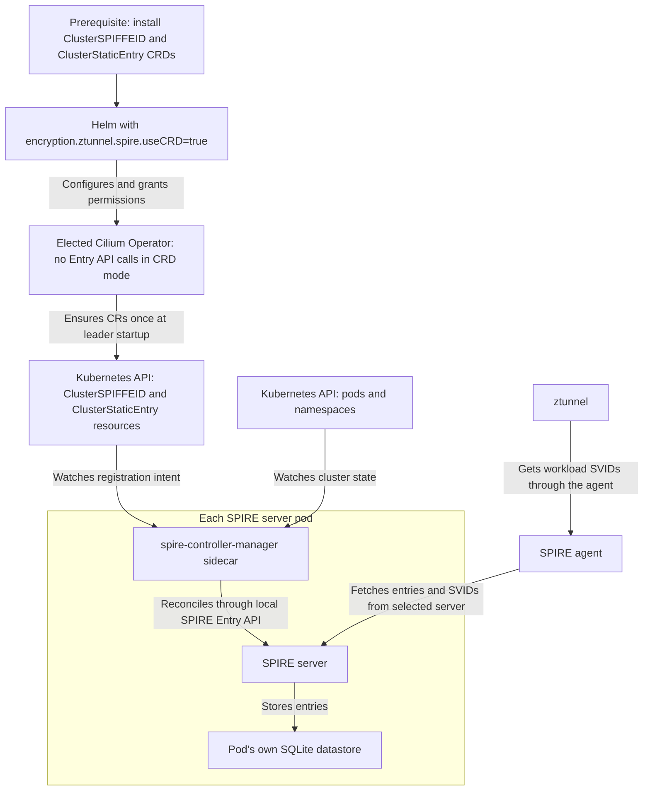
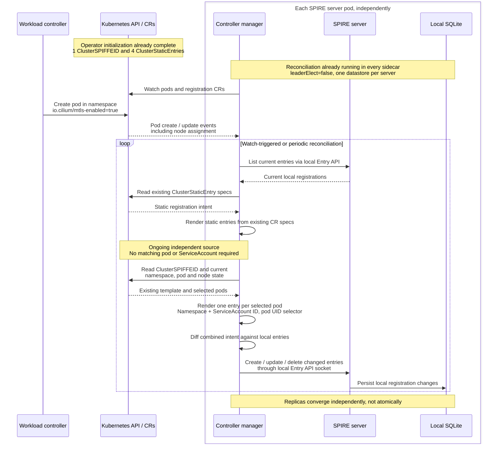
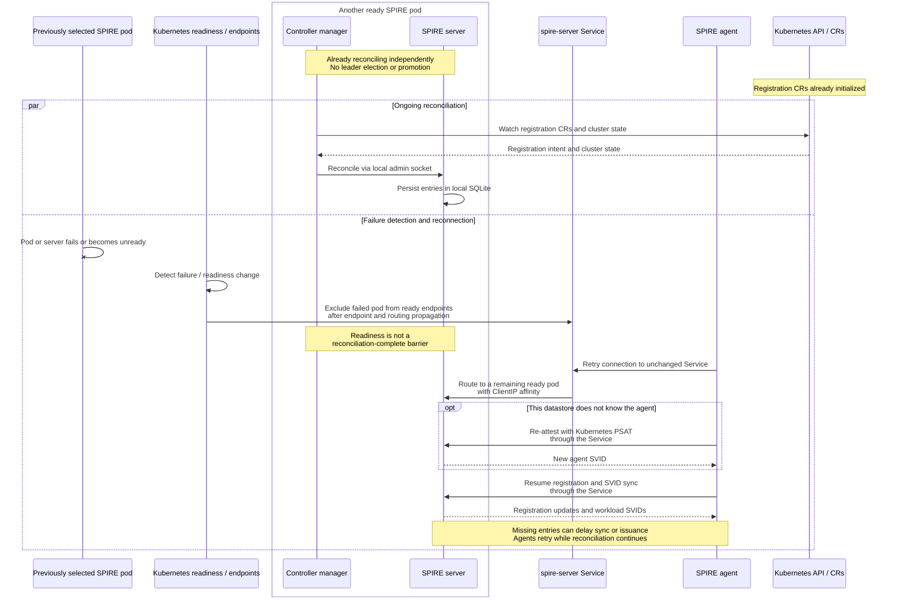

# CRD-based ztunnel Enrollment via ClusterSPIFFEID

**SIG: SIG-ServiceMesh** ([View all current SIGs](https://docs.cilium.io/en/stable/community/community/#all-sigs))

**Begin Design Discussion:** TBD

**Cilium Release:** TBD

**Authors:** Ethan Ermovick <eermovick@microsoft.com>, Tamilmani Manoharan <tamanoha@microsoft.com>

**Status:** Draft

**Related CFP:** [Mutual Authentication for Service Mesh][cfp-mutual-auth]

## Summary

Currently, the Cilium Operator registers SPIRE entries imperatively through the SPIRE Entry API, and Cilium's bundled SPIRE server stores them in a single SQLite database. This is a single point of failure, and if the SPIRE database is down workloads cannot get certs and cannot connect over mtls to other workloads.

In this CFP, we propose storing registration intent declaratively. Instead of storing registration entries directly via the Cilium Operator, we adopt the `spire-controller-manager` setup from [SPIRE Controller Manager v0.6.2][spire-controller-manager]. At elected-leader startup, the Cilium Operator ensures a single `ClusterSPIFFEID` custom resource that defines registration intent for user workloads. It also ensures 4 `ClusterStaticEntry` custom resources defining registration intent for ztunnel and bootstrap entries. In each SPIRE server pod, a `spire-controller-manager` sidecar container reconciles the registration intent with its database. Multiple redundant SPIRE server pods can then reconcile from the single `ClusterSPIFFEID` and 4 `ClusterStaticEntries` for high availability. Every SPIRE server replica's CA is signed by the same upstream CA. Therefore, if one of the SPIRE servers goes down, another can take its place so workloads can still get certs for mtls.

## Motivation

Currently, the Cilium Operator directly calls the SPIRE Entry API to upsert registrations into the SPIRE database. This server is a single replica with a local SQLite database, which is a single point of failure, so downtime on the SPIRE server lead to gaps in ability to get certs for mtls.

The `spire-controller-manager` from [SPIRE Controller Manager][spire-controller-manager] provides a solution for this issue. Using this, multiple SPIRE databases can independently recreate the registration entries, using the intent from the `ClusterSPIFFEID` and `ClusterStaticEntry` custom resources and the current cluster state. Using this system, if a SPIRE server fails, a SPIRE agent connected to it can reattest to a different SPIRE server within the same trust domain. Existing workloads with SVIDs are unaffected, new workloads may see temporary failures before their SPIRE agent has moved over to the working SPIRE server.

## Goals

* Allow the bundled SPIRE server to have multiple replicas when this feature is enabled, so that SPIRE agents can reattest to a different SPIRE server with equivalent registration entries if their server fails
* Gate the declarative registration behind `encryption.ztunnel.spire.useCRD=true` (default false)
* Leave the current SPIRE path unchanged when `encryption.ztunnel.spire.useCRD=false`
* Make no SPIRE Entry API calls from the Cilium Operator when the CRD mode is enabled
* Use the same SPIFFE IDs as the current Cilium for pods in namespaces labeled `io.cilium/mtls-enabled=true`
* When enabled, use `ClusterStaticEntry` resources to replace the SPIRE entries defined in `cilium-init`, and also create a `ztunnel` entry for ztunnel to request SVIDs from the SPIRE agent
* When multiple SPIRE server replicas are running, sign every server's CA with one shared root CA so all SVIDs chain to the same trust anchor
* Use `authentication.mutual.spire.trustDomain` as the trust domain, advertised to ztunnel

## Non-Goals

* Installing `ClusterSPIFFEID` and `ClusterStaticEntry` CRDs, these are installed manually by the user
* A replicated SQL database
* Automatic migration between enabling and disabling this feature
* Behavior change when this feature is disabled
* Replicating agent attestations across multiple SPIRE databases

## Proposal

### Overview



Currently, the Cilium Operator handles registration entries using the SPIRE Entry API to add entries to the SPIRE database. The Cilium Operator updates the entries whenever a change in service accounts or namespace enrollment requires it. In this CFP, we propose adding an option to disable Cilium Operator registration entry handling. Instead, we propose making use of the `spire-controller-manager` from [SPIRE Controller Manager][spire-controller-manager]. The SPIRE Controller Manager project adds multiple components we propose using, including the `ClusterSPIFFEID` and `ClusterStaticEntry` CRDs, and the `spire-controller-manager` sidecar container. Once per elected-leader startup, the Cilium Operator ensures a single `ClusterSPIFFEID` custom resource which defines registration intent for pods in mtls enrolled namespaces. The `ClusterSPIFFEID` provides a template for how registration entries should be created. It additionally ensures 4 `ClusterStaticEntry` resources to store registration intent for the static identities: the SPIRE agent node alias, the Cilium agent, the Cilium Operator, and ztunnel. The `spire-controller-manager` sidecar container runs in the SPIRE server pods. It repeatedly reconciles the registration intent from the `ClusterSPIFFEID` and `ClusterStaticEntry` resources into its own database using the SPIRE Entry API, at least every 10s. This feature, when enabled, replaces all Cilium Operator interactions with the SPIRE Entry API. Under this setup, multiple SPIRE servers running `spire-controller-manager` in separate pods can independently create equivalent SPIRE registration entries, allowing for redundancy.

### Prerequisites

This feature is gated behind the Helm value `encryption.ztunnel.spire.useCRD=true` (default `false`). When set to `false`, there are no changes. Additionally, the following prerequisites must be met:

* `encryption.enabled=true`
* `encryption.type=ztunnel`
* `encryption.ztunnel.ca.type=spire`
* `authentication.mutual.spire.enabled=true`
* `authentication.mutual.spire.install.enabled=true`
* The [`ClusterStaticEntry`][clusterstaticentry-crd] and [`ClusterSPIFFEID`][clusterspiffeid-crd] CRDs (`spire.spiffe.io/v1alpha1`) from [SPIRE Controller Manager v0.6.2][spire-controller-manager], the version the chart pins, must be installed before the release is applied. Their manifests are [`spire.spiffe.io_clusterstaticentries.yaml`][clusterstaticentry-crd-manifest] and [`spire.spiffe.io_clusterspiffeids.yaml`][clusterspiffeid-crd-manifest]
* Before enabling on an existing cluster, move the running server to the upstream root

### One ClusterSPIFFEID defining registration intent and registration template

[`ClusterSPIFFEID`][clusterspiffeid-crd] is a custom resource from the SPIRE Controller Manager project that serves as both a selector for which pods should have SPIRE entries and a template for those entries. The `ClusterSPIFFEID` selects pods in namespaces labeled `io.cilium/mtls-enabled=true`. Each pod in an enrolled namespace gets one entry, where the SPIFFE ID is based on the pod's namespace and ServiceAccount. If the namespace is unenrolled or the pod is deleted, the entry is deleted. Each entry is per pod, rather than per serviceaccount, as previously done by the operator.

This example is rendered with default values after enabling ztunnel encryption, SPIRE, and CRD mode, using release name `cilium` in `kube-system` and the default trust domain `spiffe.cilium`.

```yaml
apiVersion: spire.spiffe.io/v1alpha1
kind: ClusterSPIFFEID
metadata:
  name: cilium-spire-kube-system-cilium-ztunnel-workloads
spec:
  className: "cilium-spire"
  # Register every pod in namespaces enrolled with io.cilium/mtls-enabled=true.
  namespaceSelector:
    matchLabels:
      io.cilium/mtls-enabled: "true"
  # ztunnel requests the SPIFFE ID of the pod's ServiceAccount.
  spiffeIDTemplate: "spiffe://{{ .TrustDomain }}/ns/{{ .PodMeta.Namespace }}/sa/{{ .PodSpec.ServiceAccountName }}"
```

### ClusterStaticEntries for SPIRE Agents and Cilium Components

[`ClusterStaticEntry`][clusterstaticentry-crd] resources are used for static SPIRE entries and are set for the workloads below. This replaces bootstrapping by `cilium-init`, and adds an entry for `ztunnel`. These represent SPIRE entries that do not depend on pods. With default values:

* SPIRE agent node alias: SPIFFE ID `spiffe://spiffe.cilium/ns/cilium-spire/sa/spire-agent`, parent `spiffe://spiffe.cilium/spire/server`.
* Cilium agent: SPIFFE ID `spiffe://spiffe.cilium/cilium-agent`, parent `spiffe://spiffe.cilium/ns/cilium-spire/sa/spire-agent`.
* Cilium Operator: SPIFFE ID `spiffe://spiffe.cilium/cilium-operator`, parent `spiffe://spiffe.cilium/ns/cilium-spire/sa/spire-agent`.
* ztunnel: SPIFFE ID `spiffe://spiffe.cilium/ztunnel`, parent `spiffe://spiffe.cilium/ns/cilium-spire/sa/spire-agent`.

This ztunnel example is rendered with the same default values and feature settings as the `ClusterSPIFFEID` example.

```yaml
apiVersion: spire.spiffe.io/v1alpha1
kind: ClusterStaticEntry
metadata:
  name: cilium-spire-kube-system-cilium-ztunnel
spec:
  className: "cilium-spire"
  spiffeID: "spiffe://spiffe.cilium/ztunnel"
  parentID: "spiffe://spiffe.cilium/ns/cilium-spire/sa/spire-agent"
  selectors:
  - "k8s:ns:kube-system"
  - "k8s:sa:ztunnel-cilium"
```

### SPIRE Controller Manager Sidecar

The `spire-controller-manager` sidecar container runs in each SPIRE server pod. It repeatedly reads the `ClusterSPIFFEID` and `ClusterStaticEntry` resources and reconciles the registrations into a database using the SPIRE Entry API. For the registrations coming from the `ClusterSPIFFEID`, it selects pods in namespaces labeled `io.cilium/mtls-enabled=true` and creates the registration dynamically using the template. For `ClusterStaticEntry` registration entries, it does not depend on the current pods or service accounts and creates them solely based on the static entry resources. Each `spire-controller-manager` only writes to its own server's database.

### Regular operation

When a pod is created in an already enrolled namespace, every `spire-controller-manager` sidecar reconciles it independently. The existing `ClusterSPIFFEID` produces per-pod entries using current namespace, pod and node state, even when pods share a SPIFFE ID. `ClusterStaticEntry` specs remain an independent source, without waiting for matching pods or ServiceAccounts. No new CR is created per pod; each server persists changes only in its local SQLite datastore.



### Failover flow

With multiple SPIRE server replicas, failover uses ordinary Service routing, not a SPIRE leader election. This flow assumes the elected Cilium Operator has already initialized the registration CRs. Every server's controller manager runs with `leaderElect: false` and is already reconciling those CRs and cluster state into its own SQLite datastore. Losing one server does not require operator restart or reinitialization.

The `spire-server` Service keeps its application selector and uses `sessionAffinity: ClientIP` when more than one replica is configured. A failed or unready pod stops receiving new Service traffic after failure detection and endpoint/routing propagation, and agents retry against a remaining ready pod. Affinity is not a promotion mechanism and does not guarantee immediate migration of existing connections.



Pod readiness uses the SPIRE server's `/ready` and controller manager's `/readyz` probes. The controller manager's readiness check is a health ping, not a check that all registration entries exist; reconciliation errors do not necessarily make the pod unready. An agent moving to a datastore that does not know its attestation may need Kubernetes PSAT re-attestation. Neither ClientIP affinity nor the common upstream root replicates that state. Connection retries, re-attestation, and missing registration entries can temporarily delay registration updates and new workload SVID issuance. Existing unexpired SVIDs can continue to be used during this gap.

## Impacts / Key Questions

### Impact: Dependency on SPIRE Controller Manager

This new option requires new custom resource definitions and a new container image. Before this feature is enabled, the `ClusterStaticEntry` and `ClusterSPIFFEID` CRDs must be installed from the [SPIRE Controller Manager project][spire-controller-manager]. When this feature is enabled, Helm installs the `spire-controller-manager` sidecar and the elected operator ensures the custom resources. These are all new dependencies for Cilium.

### RBAC

Adds a new ClusterRole and ClusterRoleBinding for the SPIRE server's ServiceAccount to allow for reading ClusterSPIFFEIDs and ClusterStaticEntries, updating their status, and reading pods, nodes, namespaces, and Endpoints.

Helm also supplies the operator's registration configuration and grants only `get`, `create`, and `update` on `ClusterSPIFFEID` and `ClusterStaticEntry` resources. Initialization uses the operator's Kubernetes credentials, without first obtaining a SPIRE SVID.

### Restarts

Enabling this feature restarts the SPIRE server, which replaces `cilium-init` with the `spire-controller-manager` sidecar and runs as UID 1000; the SPIRE agents, whose configuration now authorizes ztunnel as a delegate; and the Cilium Operator. Changes to Helm-supplied registration configuration also restart the operator. Toggling CRD mode, or changing the trust domain while CRD mode is enabled, triggers the normal Cilium-agent DaemonSet rollout even with `rollOutCiliumPods=false`.

### Key Question: Creating the `ClusterSPIFFEID` and `ClusterStaticEntry` Custom Resources in the Operator or via Helm

The `ClusterSPIFFEID` and `ClusterStaticEntry` resources can be created by either helm upon installation, or by the Cilium Operator when it starts.

### Option 1: Create from the Operator

Once per elected-leader startup, the operator synchronously and idempotently creates or updates the single `ClusterSPIFFEID` and 4 `ClusterStaticEntry` resources. Transient failures allow up to six attempts per resource within a shared two-minute deadline; permanent or exhausted failures fail leader startup and trigger operator shutdown. Helm-owned or foreign resources are refused, not adopted; owned updates preserve status and finalizers. Resources are not automatically pruned on shutdown, disable or uninstall.

#### Pros

* No Helm-managed registration instances; Helm still supplies configuration and permissions

#### Cons

* No ongoing operator drift or deletion repair after success; repair waits for the next leader/operator startup

### Option 2: Create from the Helm Chart

Create the custom resources upon installation via helm, gated upon feature enablement.

#### Pros

* One time install

#### Cons

* Helm chart configuration necessary

## Future Milestones

* Automatic migration to enable this feature, and a migration to revert
* Duplicating agent attestations in addition to registration entries so agents do not have to reattest upon failover

<!-- Reference links -->

[cfp-mutual-auth]: https://github.com/cilium/design-cfps/blob/main/cilium/CFP-22215-mutual-auth-for-service-mesh.md
[spire-controller-manager]: https://github.com/spiffe/spire-controller-manager/tree/v0.6.2
[clusterspiffeid-crd]: https://github.com/spiffe/spire-controller-manager/blob/v0.6.2/docs/clusterspiffeid-crd.md
[clusterstaticentry-crd]: https://github.com/spiffe/spire-controller-manager/blob/v0.6.2/docs/clusterstaticentry-crd.md
[clusterspiffeid-crd-manifest]: https://raw.githubusercontent.com/spiffe/spire-controller-manager/v0.6.2/config/crd/bases/spire.spiffe.io_clusterspiffeids.yaml
[clusterstaticentry-crd-manifest]: https://raw.githubusercontent.com/spiffe/spire-controller-manager/v0.6.2/config/crd/bases/spire.spiffe.io_clusterstaticentries.yaml
