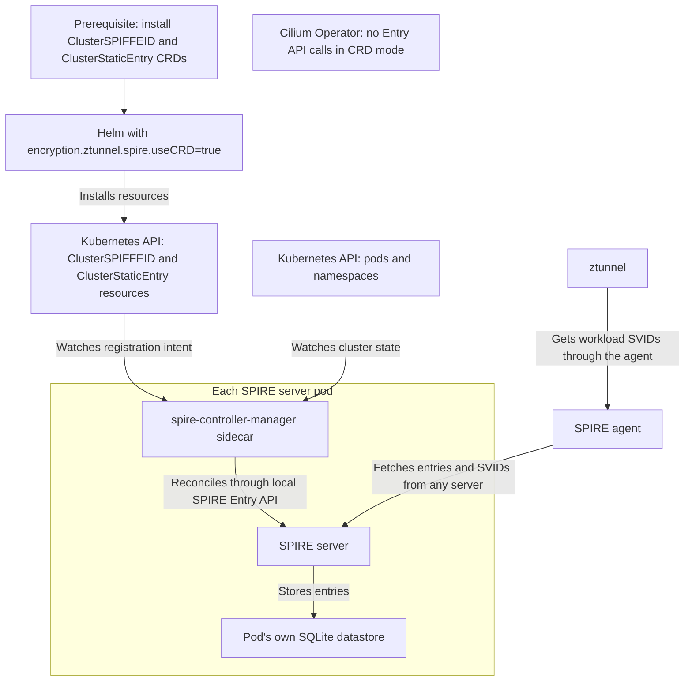

# CRD-based ztunnel Enrollment via ClusterSPIFFEID

**SIG: SIG-ServiceMesh** ([View all current SIGs](https://docs.cilium.io/en/stable/community/community/#all-sigs))

**Begin Design Discussion:** TBD

**Cilium Release:** TBD

**Authors:** Ethan Ermovick <eermovick@microsoft.com>, Tamilmani Manoharan <tamanoha@microsoft.com>

**Status:** Draft

**Related CFP:** [Mutual Authentication for Service Mesh][cfp-mutual-auth]

## Summary

Currently, the Cilium Operator registers SPIRE entries imperatively through the SPIRE Entry API, and Cilium's bundled SPIRE server stores them in a single SQLite database. With this setup, we cannot have multiple redundant databases for SPIRE registration entries.

In this CFP, we propose storing registration intent declaratively. Instead of storing registration entries directly via the Cilium Operator, we adopt the `spire-controller-manager` setup from [SPIRE Controller Manager v0.6.2][spire-controller-manager]. Upon installation, Helm creates a single `ClusterSPIFFEID` custom resource that defines registration intent for user workloads. Helm also creates 4 `ClusterStaticEntry` custom resources defining registration intent for ztunnel and bootstrap entries. In each SPIRE server pod, a `spire-controller-manager` sidecar container reconciles the registration intent with its database. Multiple redundant SPIRE server pods can then reconcile from the single `ClusterSPIFFEID` for high availability. All SPIRE server replicas connect to the same root trust domain.

## Motivation

Currently, the Cilium Operator directly calls the SPIRE Entry API to upsert registrations into the SPIRE database. The SPIRE Entry API only connects to a single database, so entries are not replicated. This is a single point of failure.

The `spire-controller-manager` from [SPIRE Controller Manager][spire-controller-manager] provides a solution for this issue. Using this, multiple SPIRE databases can independently recreate the registration entries, using the intent from the `ClusterSPIFFEID` custom resource and the current cluster state. Using this system, if a SPIRE server fails, a SPIRE agent connected to it can reattest to a different SPIRE server within the same trust domain.

## Goals

* Allow the bundled SPIRE server to have multiple replicas when this feature is enabled, so that SPIRE agents can reattest to a different SPIRE server with the same registration entries if their server fails
* Gate the declarative registration behind `encryption.ztunnel.spire.useCRD=true` (default false)
* Leave the current SPIRE path unchanged when `encryption.ztunnel.spire.useCRD=false`
* Make no SPIRE Entry API calls from the Cilium Operator when the CRD mode is enabled
* Use the same SPIFFE IDs as the current Cilium for pods in namespaces labeled `io.cilium/mtls-enabled=true`
* When enabled, use `ClusterStaticEntry` resources to replace the SPIRE entries defined in `cilium-init`
* Have all SPIRE servers connect to the same upstream trust root

## Non-Goals

* Installing `ClusterSPIFFEID` and `ClusterStaticEntry` CRDs, these are installed manually by the user
* A replicated SQL database
* Automation migration between enabling and disabling this feature
* Behavior change when this feature is disabled
* Replicating agent attestations across multiple SPIRE databases

## Proposal

### Overview



Currently, the Cilium Operator handles registration entries using the SPIRE Entry API to add entries to the SPIRE database. The Cilium Operator updates the entries whenever a changes in service accounts or namespace enrollment requires it. In this CFP, we propose adding an option to disable Cilium Operator registration entry handling. Instead, we propose making use of the `spire-controller-manager` from [SPIRE Controller Manager][spire-controller-manager]. The SPIRE Controller Manager project adds multiple components we propose using, including the `ClusterSPIFFEID` and `ClusterStaticEntry` CRDs, and the `spire-controller-manager` sidecar container. Upon installation, Helm creates a single `ClusterSPIFFEID` custom resource. This defines registration intent for user-managed service accounts. The `ClusterSPIFFEID` provides a template for how registration entries should be created. Additionally, Helm creates `ClusterStaticEntry` resources to store registration intent for static workloads. The `spire-controller-manager` sidecar container runs in the SPIRE server pods. It repeatedly reconciles the registration intent from the `ClusterSPIFFEID` and `ClusterStaticEntry` resources into a database using the SPIRE Entry API, asynchronously. This feature, when enabled, replaces all Cilium Operator interactions with the SPIRE Entry API. Under this setup, multiple SPIRE servers running `spire-controller-manager` in separate pods can independently create equivalent SPIRE registration entries, allowing for redundancy.

### Prerequisites

This feature is gated behind the Helm value `encryption.ztunnel.spire.useCRD=true` (default `false`). When set to `false`, there are no changes. Additionally, the following must be set:
*encryption.enabled=true, encryption.type=ztunnel, encryption.ztunnel.ca.type=spire, authentication.mutual.spire.enabled=true and authentication.mutual.spire.install.enabled=true
[todo agent clean this list up]
*[todo agent add links] CRDs for clusterstaticentry and clusterspiffeid + todo agent add unless clause 

### One ClusterSPIFFEID defining registration intent and registration template

[`ClusterSPIFFEID`][clusterspiffeid-crd] is a custom resource from the SPIRE Controller Manager project that serves as both a selector for which pods should have SPIRE entries and a template for those entries. The `ClusterSPIFFEID` selects pods in namespaces labeled [todo agent]. Each pod in an enrolled namespace gets one entry, where the SPIFFE ID is based on the pod's namespace and ServiceAccount. If the namespace is unenrolled or the pod is deleted, the entry is deleted.

This example is rendered with default values after enabling ztunnel encryption, SPIRE, and CRD mode, using release name `cilium` in `kube-system` and the default trust domain `spiffe.cilium`.

```yaml
apiVersion: spire.spiffe.io/v1alpha1
kind: ClusterSPIFFEID
metadata:
  name: cilium-spire-kube-system-cilium-ztunnel-workloads
spec:
  className: "cilium-spire"
  # Register every pod in namespaces enrolled with io.cilium/mtls-enabled=true.
  namespaceSelector:
    matchLabels:
      io.cilium/mtls-enabled: "true"
  # ztunnel requests the SPIFFE ID of the pod's ServiceAccount.
  spiffeIDTemplate: "spiffe://{{ .TrustDomain }}/ns/{{ .PodMeta.Namespace }}/sa/{{ .PodSpec.ServiceAccountName }}"
```

### ClusterStaticEntries for static service accounts

[`ClusterStaticEntry`][clusterstaticentry-crd] resources are used for static SPIRE entries and are set for the workloads below. This replaces bootstrapping by `cilium-init`. These represent SPIRE entries that do not depend on pods. With default values:

* SPIRE agent node alias: SPIFFE ID `spiffe://spiffe.cilium/ns/cilium-spire/sa/spire-agent`, parent `spiffe://spiffe.cilium/spire/server`.
* Cilium agent: SPIFFE ID `spiffe://spiffe.cilium/cilium-agent`, parent `spiffe://spiffe.cilium/ns/cilium-spire/sa/spire-agent`.
* Cilium Operator: SPIFFE ID `spiffe://spiffe.cilium/cilium-operator`, parent `spiffe://spiffe.cilium/ns/cilium-spire/sa/spire-agent`.
* ztunnel: SPIFFE ID `spiffe://spiffe.cilium/ztunnel`, parent `spiffe://spiffe.cilium/ns/cilium-spire/sa/spire-agent`.

This ztunnel example is rendered with the same default values and feature settings as the `ClusterSPIFFEID` example.

```yaml
apiVersion: spire.spiffe.io/v1alpha1
kind: ClusterStaticEntry
metadata:
  name: cilium-spire-kube-system-cilium-ztunnel
spec:
  className: "cilium-spire"
  spiffeID: "spiffe://spiffe.cilium/ztunnel"
  parentID: "spiffe://spiffe.cilium/ns/cilium-spire/sa/spire-agent"
  selectors:
  - "k8s:ns:kube-system"
  - "k8s:sa:ztunnel-cilium"
```

### SPIRE Controller Manager Sidecar

The `spire-controller-manager` sidecar container runs in each SPIRE server pod. It repeatedly reads the `ClusterSPIFFEID` and `ClusterStaticEntry` resources and reconciles the registrations into a database using the SPIRE Entry API. For the registrations coming from the `ClusterSPIFFEID`, it selects pods based on the selectors in the `ClusterSPIFFEID` and creates the registration dynamically using the template. For `ClusterStaticEntry` registration entries, it does not depend on the current pods or service accounts and creates them solely based on the static entry resources.

## Impacts / Key Questions

### Impact: Dependency on SPIRE Controller Manager

This new option requires new custom resource definitions and container images. Before this feature is enabled, the `ClusterStaticEntry` and `ClusterSPIFFEID` CRDs must be installed from the [SPIRE Controller Manager project][spire-controller-manager]. When this feature is enabled in Helm, the chart creates the custom resources and installs the `spire-controller-manager` sidecar. These are all new dependencies for Cilium.

### Key Question: High availability via SPIRE CRDs with multiple databases vs a single replicated database

This proposal suggests using declaratively stored custom resources for SPIRE registration intent, with the option for multiple independent databases reconciling the entries for redundancy. This is in contrast with a single database with built-in replication.

### Option 1: Independent databases reconciled from CRDs

This current proposal suggests storing SPIRE registration intent as custom resources, from which the `spire-controller-manager` can then rebuild the SPIRE entries. Doing this on multiple databases with multiple `spire-controller-manager` instances creates redundancy.

#### Pros

* Ability to have multiple redundant databases
* Multiple simple databases have less overhead than a single high-availability database

#### Cons

* Only SPIRE registration data is replicated, so agents would have to reattest upon failover

### Option 2: A single database with built-in replication

Use a SPIRE database with built-in redundancy, such as PostgreSQL operating across multiple nodes.

#### Pros

* Redundancy of all data, rather than just registration data, so agents wouldn't have to reattest during failover

#### Cons

* More database configuration overhead

# Future Milestones

* Migration between enabling and disabling this feature
* Duplicating agent attestations in addition to registration entries

<!-- Reference links -->

[cfp-mutual-auth]: https://github.com/cilium/design-cfps/blob/main/cilium/CFP-22215-mutual-auth-for-service-mesh.md
[spire-controller-manager]: https://github.com/spiffe/spire-controller-manager/tree/v0.6.2
[clusterspiffeid-crd]: https://github.com/spiffe/spire-controller-manager/blob/v0.6.2/docs/clusterspiffeid-crd.md
[clusterstaticentry-crd]: https://github.com/spiffe/spire-controller-manager/blob/v0.6.2/docs/clusterstaticentry-crd.md
