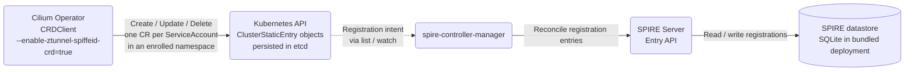

# CRD-based ztunnel Enrollment via ClusterStaticEntry

**SIG: SIG-ServiceMesh** ([View all current SIGs](https://docs.cilium.io/en/stable/community/community/#all-sigs))

**Begin Design Discussion:** 2026-10-08

**Cilium Release:** TBD

**Authors:** Ethan Ermovick <eermovick@microsoft.com>, Karina Ranadive <karanadive@microsoft.com>

**Status:** Draft

**Related CFP:** [Mutual Authentication for Service Mesh][cfp-mutual-auth]

## Summary

Currently, the Cilium Operator registers SPIRE entries imperatively through the SPIRE Entry API, and Cilium's bundled SPIRE server stores them in a single SQLite database. With this setup, we cannot have a replicated database for SPIRE registration entries.

In this CFP, we propose storing registration intent declaratively. The Cilium Operator records this intent as one `ClusterStaticEntry` custom resource per service account in each namespace enrolled in SPIRE-backed ztunnel mTLS. Kubernetes stores this intent persistently in etcd, which can be replicated. The `spire-controller-manager` then reconciles this intent into the SPIRE datastore through the SPIRE Entry API. Multiple instances of the `spire-controller-manager`, SPIRE server, and datastore can be run for redundancy.

This new dataflow is off by default, but can be enabled by setting `encryption.ztunnel.spire.useCRD=true` in Helm. This setting will also install the `ClusterStaticEntry` CRD and the `spire-controller-manager`.

## Motivation

The current method of registering SPIRE identities couples the Cilium Operator directly to the SPIRE Entry API. This creates concerns for high availability, because registration entries are stored imperatively, and multiple SPIRE databases cannot be used.

`spire-controller-manager` provides `ClusterStaticEntry` custom resources, a declarative way to store registration intent. The Kubernetes control plane stores these custom resources and can be configured for redundancy. The `spire-controller-manager` then reconciles this intent into a SPIRE database. The main benefit is decoupling the registration intent from the SPIRE database, so the database can be managed independently. With registration intent decoupled, a `spire-controller-manager` paired with each of several redundant SPIRE servers can reconstruct SPIRE registrations from the Kubernetes resources. Even with one SPIRE server, the `spire-controller-manager` can recreate SPIRE entries after a restart that loses the server's datastore.

## Goals

* Integrate `spire-controller-manager` and `ClusterStaticEntry` into Cilium's SPIRE install so SPIRE registration is declarative rather than imperative Entry API calls
* Gate the declarative registration behind `encryption.ztunnel.spire.useCRD=true` (default false)
* Keep the existing Entry API path as the default, with no behavior change when the flag is off
* Only change custom resources owned by the Cilium Operator
* Make SPIRE Entry API calls from the `spire-controller-manager` rather than the Cilium Operator
* Match the current behavior of creating SPIRE entries
* Match the structure of the existing Cilium Operator SPIRE client by implementing the [`SpireClient`][spire-client] interface:
```go
type SpireClient interface {
	Upsert(context.Context, string) error
	UpsertBatch(context.Context, []string) error
	Delete(context.Context, string) error
	DeleteBatch(context.Context, []string) error
	Initialized() <-chan struct{}
}
```
* Implement the optional [`ServiceAccountPruner`][sa-pruner] interface:
```go
type ServiceAccountPruner interface {
	Prune(ctx context.Context, namespace string, keep func(id string) bool) error
}
```

## Non-Goals

* SPIRE agent, Cilium agent, or mTLS datapath changes
* Trust-root / CA management changes

## Proposal

### Overview



The ztunnel enrollment reconciler already abstracts registration behind a small `SpireClient` interface (`Upsert`, `UpsertBatch`, `Delete`, `DeleteBatch`, `Initialized`). This CFP adds a second implementation of that interface in the SPIRE client package, selected at startup by the new flag, so the interface itself is unchanged. The new client also implements the optional `ServiceAccountPruner` interface. In the new implementation, the Cilium Operator writes `ClusterStaticEntry` resources, and the `spire-controller-manager` reconciles them into SPIRE asynchronously.

### Operator flag and client wiring

The feature is gated behind the operator flag [`--enable-ztunnel-spiffeid-crd`][flag-register] (config field [`UseCRD`][config-field], default off). When enabled, [`NewClient`][new-client] selects the new `CRDClient` instead of the existing Entry API client (`EntryClient`). The flag requires `--enable-ztunnel` and `--ztunnel-ca-type=spire`.

At startup, the CRD client does not wait for a connection to the SPIRE Entry API; `Initialized` is closed as soon as the operator starts. Its methods (`Upsert`, `Delete`, etc.) create, update, and delete `ClusterStaticEntry` resources instead of calling the Entry API.

### One ClusterStaticEntry per service account in an enrolled namespace

For each service account in an enrolled namespace, the backend creates one cluster-scoped `ClusterStaticEntry` custom resource ([`buildClusterStaticEntry`][build-cse]):

```go
obj.Object["spec"] = map[string]any{
    "spiffeID":  "spiffe://" + entry.SpiffeId.TrustDomain + entry.SpiffeId.Path,
    "parentID":  "spiffe://" + entry.ParentId.TrustDomain + entry.ParentId.Path,
    "selectors": selectors,
}
```

Design points:

* **One CR per service account:** matches workloads by namespace and service account using the `k8s:ns:<namespace>` and `k8s:sa:<service-account>` selectors, with the explicit SPIFFE ID `spiffe://<trust-domain>/ns/<namespace>/sa/<service-account>`
* **Parent ID:** `spiffe://<trust-domain>/ztunnel`, the same as the existing Entry API client
* **Only owned fields are updated:** [`Upsert`][upsert] only mutates the fields the operator owns (`spec.spiffeID`, `spec.parentID`, `spec.selectors`, and the namespace label), and leaves all other fields unchanged
* **Ownership label:** the operator sets `app.kubernetes.io/managed-by: cilium-operator-ztunnel` on every `ClusterStaticEntry` it creates, along with a `spire.cilium.io/namespace` label and a `spire.cilium.io/service-account` annotation. It only updates or deletes CRs that carry the ownership label, so CRs owned by anything else are not modified
* **Deterministic, DNS-safe names:** [`crdEntryName`][entry-name] produces `ztunnel-<namespace>.<service-account>`, and falls back to a truncated name plus a SHA-256 hash when that would exceed the 253-character object-name limit

### Unenrollment cleanup

When a namespace is unenrolled from SPIRE, the reconciler's [`Delete`][reconciler-delete] calls [`CRDClient.Prune`][crd-prune] for that namespace. `Prune` lists the operator-owned custom resources in the unenrolled namespace and deletes the ones that are no longer desired. The reconciler also runs [`Prune`][reconciler-prune] [every minute][prune-interval] across all namespaces to clean up stale registrations.

Deleting an individual service account removes its associated `ClusterStaticEntry`.

## Impacts / Key Questions

### Impact: dependency on spire-controller-manager and the CRD

This backend only produces SPIRE entries if the `ClusterStaticEntry` CRD is installed and a `spire-controller-manager` is running and reconciling those resources into the SPIRE server. Because Cilium maintains the SPIRE install and includes neither today, enabling this backend requires the following additions to Cilium's SPIRE chart (all gated behind the Helm toggle; with the flag off, none of it is installed and behavior is unchanged):

* **`ClusterStaticEntry` CRD:** install the CRD manifest from the `spire-controller-manager` project
* **`spire-controller-manager` workload:** deploy it as a sidecar in the existing `spire-server` StatefulSet, sharing the server's API socket `/tmp/spire-server/private/api.sock`. Use the upstream `spiffe/spire-controller-manager` image, configured to watch `ClusterStaticEntry` resources and reconcile them into the co-located server
* **Controller-manager RBAC:** watch `ClusterStaticEntry` resources and update their status
* **Validating webhook:** `spire-controller-manager` serves a validating webhook for `ClusterSPIFFEID` and `ClusterFederatedTrustDomain` (not `ClusterStaticEntry`); the chart must either configure it or disable it with `ENABLE_WEBHOOKS=false`
* **Operator RBAC:** allow the `cilium-operator` service account to get, list, create, update, and delete `ClusterStaticEntry` resources
* **Flag plumbing:** the Helm value `encryption.ztunnel.spire.useCRD=true` sets `enable-ztunnel-spiffeid-crd` in the operator config and installs the above

The SPIRE server config is otherwise unchanged: the server already exposes the API socket that the controller manager connects to.

### Key Question: Per-namespace vs per-service-account custom resources

For this proposal, the custom resources can represent either the namespaces enrolled in SPIRE mTLS or the service accounts in enrolled namespaces.

### Option 1:

Store one custom resource per service account in an enrolled namespace, as this proposal currently suggests.

#### Pros

* The new CRD-based `SpireClient` matches the existing Entry API client in what its methods (e.g. `Upsert`, `Delete`) do
* More flexibility for possible future per-service-account SPIRE enrollment

#### Cons

* More custom resources

### Option 2:

Store the enrolled namespaces as custom resources and depend on the `spire-controller-manager` to reconcile which service accounts are enrolled.

#### Pros

* Fewer custom resources

#### Cons

* Greater difference between the new and old `SpireClient` implementations
* Less flexibility for possible future per-service-account SPIRE enrollment

### Key Question: High availability via SPIRE CRDs with multiple databases vs a single replicated database

This proposal suggests using declaratively stored custom resources for SPIRE registration intent, with the option for multiple independent databases reconciling the entries for redundancy. This is in contrast with a single database with built-in replication.

### Option 1:

This current proposal suggests storing SPIRE registration intent as custom resources, from which the `spire-controller-manager` can then rebuild the SPIRE entries. Doing this on multiple databases with multiple `spire-controller-manager` instances creates redundancy.

#### Pros

* Ability to have multiple redundant databases
* Multiple simple databases have less overhead than a single high-availability database

#### Cons

* Only SPIRE registration data is replicated, so agents would have to reattest upon failover

### Option 2:

Use a SPIRE database with built-in redundancy, such as PostgreSQL operating across multiple nodes.

#### Pros

* Redundancy of all data, rather than just registration data, so agents wouldn't have to reattest during failover

#### Cons

* More database configuration overhead

<!-- Reference links -->

[cfp-mutual-auth]: https://github.com/cilium/design-cfps/blob/main/cilium/CFP-22215-mutual-auth-for-service-mesh.md
[flag-register]: https://github.com/Arleee1/cilium/blob/5e402e4b4c5ae9662ff6cbda7d8d5aed8d1a7571/operator/pkg/ztunnel/spire/client.go#L71-L73
[config-field]: https://github.com/Arleee1/cilium/blob/5e402e4b4c5ae9662ff6cbda7d8d5aed8d1a7571/operator/pkg/ztunnel/spire/client.go#L46-L47
[new-client]: https://github.com/Arleee1/cilium/blob/5e402e4b4c5ae9662ff6cbda7d8d5aed8d1a7571/operator/pkg/ztunnel/spire/client.go#L130-L147
[spire-client]: https://github.com/Arleee1/cilium/blob/5e402e4b4c5ae9662ff6cbda7d8d5aed8d1a7571/operator/pkg/ztunnel/spire/client.go#L108-L120
[sa-pruner]: https://github.com/Arleee1/cilium/blob/5e402e4b4c5ae9662ff6cbda7d8d5aed8d1a7571/operator/pkg/ztunnel/spire/client.go#L122-L127
[build-cse]: https://github.com/Arleee1/cilium/blob/5e402e4b4c5ae9662ff6cbda7d8d5aed8d1a7571/operator/pkg/ztunnel/spire/crd_client.go#L107-L136
[upsert]: https://github.com/Arleee1/cilium/blob/5e402e4b4c5ae9662ff6cbda7d8d5aed8d1a7571/operator/pkg/ztunnel/spire/crd_client.go#L151-L190
[entry-name]: https://github.com/Arleee1/cilium/blob/5e402e4b4c5ae9662ff6cbda7d8d5aed8d1a7571/operator/pkg/ztunnel/spire/crd_client.go#L92-L105
[crd-prune]: https://github.com/Arleee1/cilium/blob/5e402e4b4c5ae9662ff6cbda7d8d5aed8d1a7571/operator/pkg/ztunnel/spire/crd_client.go#L242-L301
[reconciler-delete]: https://github.com/Arleee1/cilium/blob/5e402e4b4c5ae9662ff6cbda7d8d5aed8d1a7571/operator/pkg/ztunnel/reconciler/reconciler.go#L81-L119
[reconciler-prune]: https://github.com/Arleee1/cilium/blob/5e402e4b4c5ae9662ff6cbda7d8d5aed8d1a7571/operator/pkg/ztunnel/reconciler/reconciler.go#L121-L134
[prune-interval]: https://github.com/Arleee1/cilium/blob/5e402e4b4c5ae9662ff6cbda7d8d5aed8d1a7571/operator/pkg/ztunnel/cell.go#L60-L61
